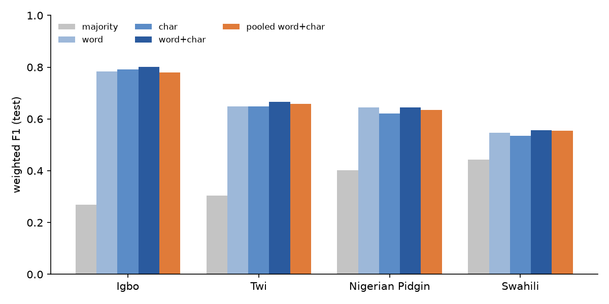
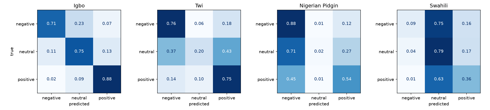
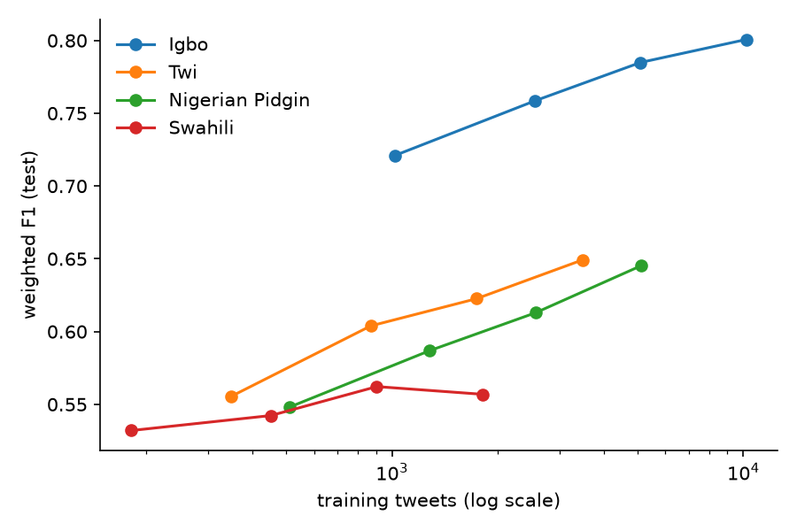

# afrisenti-baselines

How well can a small, fast model tell whether a tweet is positive, negative or neutral when the tweet is in Igbo, Twi, Nigerian Pidgin or Swahili?

Most sentiment tools are built for English, and many of them quietly fail on African languages. Before reaching for a large multilingual transformer, I want to know what a strong classical baseline already gets, where it breaks, and whether the fix is a better model or better data. That is the question I ask before every speech and language project, so this repo answers it for sentiment.

**The data is real.** It's the [AfriSenti SemEval-2023](https://github.com/afrisenti-semeval/afrisent-semeval-2023) tweet dataset (Muhammad et al., 2023), labelled by native speakers. I picked Igbo and Twi because they're the next languages my team is working on, and Nigerian Pidgin and Swahili because they're widely spoken and behave very differently. The data isn't copied into this repo: `data.py` downloads the official splits the first time you train.

## Run it

```
uv sync
uv run python -m afrisenti_baselines.train
uv run pytest
```

Training takes about 2.5 minutes on a laptop CPU. It writes `reports/metrics.json` and the charts in `reports/figures/`, and saves the pooled model for scoring new text:

```
uv run python -m afrisenti_baselines.predict "this jollof sweet die" "wahala dey o, light don go again"
positive  negative=0.01  neutral=0.00  positive=0.99  | this jollof sweet die
negative  negative=0.96  neutral=0.00  positive=0.03  | wahala dey o, light don go again
```

## How it's evaluated

- Official train, dev and test splits. The regularisation strength `C` is tuned on dev, and test is only used to score the final models.
- The headline metric is **weighted F1**, the official AfriSenti metric. I also report **macro F1**, because weighted F1 can look fine while a small class is being ignored completely.
- Every language gets its own model. A **pooled** model is also trained on all four languages together and then scored on each one separately.

| | Igbo | Twi | Nigerian Pidgin | Swahili |
|---|---|---|---|---|
| training tweets | 10,192 | 3,481 | 5,121 | 1,810 |
| majority class | 0.27 | 0.31 | 0.40 | 0.44 |
| word TF-IDF + logistic regression | 0.78 | 0.65 | 0.64 | 0.55 |
| character n-gram TF-IDF + LR | 0.79 | 0.65 | 0.62 | 0.53 |
| **word + character + LR** | **0.80** | **0.67** | **0.65** | **0.56** |
| pooled word + character (all 4 languages) | 0.78 | 0.66 | 0.63 | 0.56 |
| *macro F1 of the best model* | *0.80* | *0.59* | *0.47* | *0.48* |

*Weighted F1 on the test set, except the last row.*



## What the numbers say

**Combining word and character features wins in every language, but only by a little.** Character n-grams help most in Igbo and Twi, where the same word is spelled with or without tone marks and with or without ụ, ọ, ɛ and ɔ. Normalising text to NFC (so a decomposed "u + dot below" matches "ụ") is part of what makes that work. In Pidgin, word features alone beat character features alone (0.64 vs 0.62), which makes sense for an English-based creole with fairly stable spellings.

**One pooled model nearly matches four separate ones.** It's at most 0.02 behind in every language. In production that's a reasonable trade: one model to deploy, monitor and retrain instead of four. It also means pooling doesn't give the small languages a boost on its own, so more data for those languages would matter more than sharing.

**Nigerian Pidgin has a label shift between splits.** Only 1.4% of training and dev tweets are neutral, but 10.4% of test tweets are. The model has barely seen neutral, so it almost never predicts it: 71% of neutral Pidgin tweets are called negative. That's why dev F1 (0.71) overstates test F1 (0.65), and why macro F1 is 0.47. In a real deployment this is the drift you'd want monitoring to catch.

**In Swahili the model mostly says "neutral".** 59% of Swahili tweets are neutral, so 75% of negative tweets get absorbed into it. The learning curve is flat (training on 50% or 100% of the data gives the same score), so more of the same data won't fix it. It needs more negative examples, or a model that understands the language better.



**Twi has the most to gain from more data.** Its learning curve is still climbing at 3,481 tweets, and so are Igbo's and Pidgin's. Neutral Twi tweets are the hard part: the pooled model recognises only 20% of them.



**A failure worth showing.** "me ani agye paa" ("I'm very happy" in Twi) is scored as *negative* (0.63). None of these words carry enough sentiment in a bag-of-n-grams model trained on 3,481 tweets. A pretrained African-language model should handle it, which is the next step.

## Layout

```
src/afrisenti_baselines/
  data.py      download + load the official splits
  text.py      language-agnostic tweet cleaning
  models.py    majority, word, char, word+char pipelines
  train.py     tuning, evaluation, learning curves, charts
  predict.py   score new text with the pooled model
tests/         cleaning, loading and model tests (no network needed)
reports/       metrics.json and figures from the last run
```

## Things I'd do next

- Fine-tune an African-language encoder (AfroXLMR or AfriBERTa) on the same splits and check that it beats these baselines in *every* language, not just on average
- For Pidgin, reweight or resample so the model sees enough neutral examples, then re-measure macro F1
- Calibrate the probabilities and send low-confidence tweets to a human, as in [rubatsiro](https://github.com/DreyMuch/rubatsiro)
- Add more AfriSenti languages (Hausa, Yoruba, Kinyarwanda) to see whether pooling starts to help once more related languages are in the mix
- Have a native speaker check a sample of errors, since some of them will be label noise and not model mistakes

## Data and citation

AfriSenti is the work of its authors and annotators. If you use it, cite:

> Shamsuddeen Hassan Muhammad et al. 2023. *AfriSenti: A Twitter Sentiment Analysis Benchmark for African Languages.* EMNLP 2023.

The code in this repo is MIT licensed. The dataset's terms are set by the AfriSenti authors.
